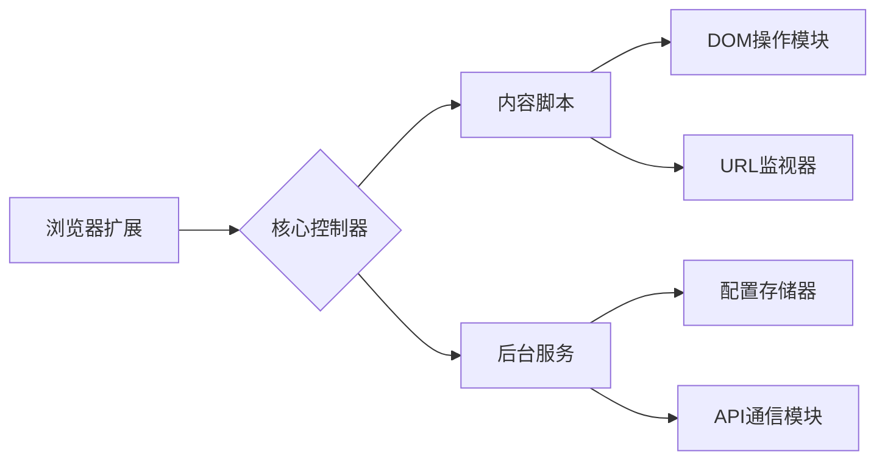

```markdown
# 浏览器自动化消息助手 - 项目说明文档
## 一、项目概述
### 1.1 背景需求
开发一款能在聊天页面自动执行以下操作的浏览器插件：
- ⚡ **智能发送消息**：在指定输入框填充自定义内容并触发发送
- 🔗 **动态改写URL**：发送后自动更新地址栏中特定格式的ID参数
- 🔄 **数据通道拓展**：支持多途径获取动态变化的ID参数
- 🛠️ **高度可配置化**：允许非技术人员通过界面管理流程
### 1.2 适用环境
- **支持浏览器**：所有Chromium内核浏览器（Chrome/战斧/Edge）
- **目标网站**：URL包含可识别ID段（如`/ID123456/`结构）的聊天平台
## 二、核心功能清单
### 2.1 消息自动化系统
| 模块 | 功能描述 | 技术要点 |
|------|----------|----------|
| 消息定位 | 智能识别页面输入框 | • CSS选择器智能匹配<br>• XPath动态分析 |
| 内容填充 | 支持预定义消息模板 | • 占位符系统（{{DATE}} {{TIME}}）<br>• Markdown/HTML格式可选 |
| 触发机制 | 模拟真实用户点击操作 | • 随机延迟(0.5-3秒)<br>• 焦点切换动画模拟 |
| 循环发送 | 可配置消息发送间隔 | • 定时任务队列管理<br>• 最大发送次数限制 |
### 2.2 ID参数处理引擎
```javascript
// ID 替换逻辑示例
const detectIDPattern = /\/ID(\d+)\//; // 识别标准ID结构
const newID = generateDynamicID(); // 从配置源获取新ID
window.history.replaceState({}, "", window.location.href.replace(detectIDPattern, `/ID${newID}/`));
```
#### 数据源支持：
- **手动模式**：弹出窗口直接输入
- **文件模式**：上传CSV/TXT批量导入
- **API模式**：对接外部RESTful接口
- **算法生成**：按预设规则自动生成（如时间戳+随机数）
### 2.3 用户配置面板
## 三、技术实现方案
### 3.1 架构设计

### 3.2 关键技术点
| 组件 | 实现方案 | 兼容性处理 |
|------|----------|------------|
| 脚本注入 | `chrome.scripting.executeScript` | 战斧浏览器使用`browser`命名空间 |
| 存储方案 | `chrome.storage.local` 加密存储 | 数据加密采用AES-256 |
| 跨域通信 | `chrome.runtime.sendMessage` | 消息通道加密校验 |
## 四、开发里程碑
### Phase 1 - 基础功能 (1 Week)
- [ ] Manifest V3配置框架搭建
- [ ] 输入框基础定位功能
- [ ] URL参数改写原型
### Phase 2 - 增强功能 (1 Week)
- [ ] 可视化配置界面开发
- [ ] API数据源对接模块
- [ ] 智能元素检测算法
### Phase 3 - 安全加固 (3 Days)
- [ ] XSS过滤白名单
- [ ] 操作异常熔断机制
- [ ] 权限最小化配置
## 五、使用场景示例
**案例：电商客服系统**
1. 自动发送预设欢迎语：
   ```text
   "您好！您咨询的订单{{ORDER_ID}}我们已收到..."
   ```
2. 发送后更新URL中的会话ID：
   ```diff
   - www.example.com/support/ID123456/
   + www.example.com/support/ID789012/
   ```
3. 从ERP系统API获取新订单ID
## 六、安全声明
1. 遵循GDPR数据保护条例
2. 不会收集用户的隐私信息
3. 所有外部请求均需用户显式授权
4. 源码可接受安全审计
## 七、常见问题指南
**Q1: 如何防止被网站检测为机器人？**
A: 内置以下反检测策略：
- 随机移动轨迹生成
- 输入速度正态分布模拟
- 自定义请求头伪装
**Q2: 能否批量管理多个网站的配置？**
A: 支持配置分组管理功能，可通过切换场景Profile适配不同网站
```